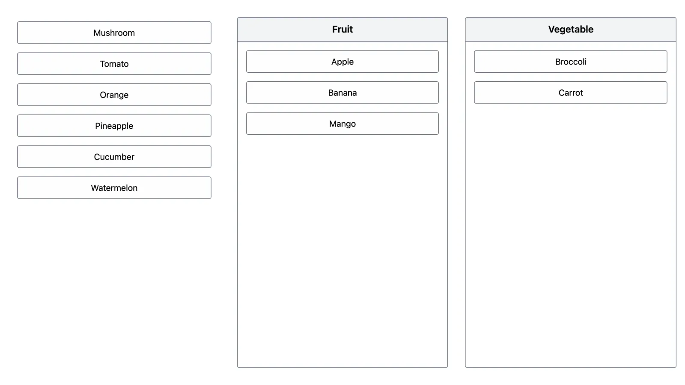

# Auto Delete List

Auto delete todo list: items move to their type column and return after 5 seconds.

Part 1 of the [7Solutions frontend assignment](https://github.com/7-solutions/frontend-assignment). See the [workspace README](../../README.md) for setup.

## Demo

**Live:** https://auto-delete-list-ddz6ii.vercel.app



## Features

- Clicking an item in the main list moves it to the column matching its type (Fruit or Vegetable).
- After **5 seconds** in a column, the item automatically returns to the **bottom** of the main list.
- Clicking an item in a column returns it to the main list immediately and cancels its timer.
- Each item has its own independent timer.
- Responsive layout: stacked on mobile, three columns on desktop.

## Run

| From the repo root | Inside `apps/web` | Description                        |
| ------------------ | ----------------- | ---------------------------------- |
| `vp run dev`       | `vp dev`          | Start the dev server with HMR      |
| `vp run build`     | `vp build`        | Build for production               |
| `vp run preview`   | `vp preview`      | Serve the production build locally |

`vp run build` from the root runs the app's `build` script (`tsc -b && vp build`), so it also type checks; the built-in `vp build` inside `apps/web` skips the type check.

## Project structure

```
src/
├── components/  UI: board layout, item list, item button, type column, AutoDeleteList
├── hooks/       useAutoDelete (state + timers), useMoveFeedback (focus + announcements)
├── lib/         board-state: pure state transitions
├── data/        seed items
├── types/       Item and ItemType definitions
└── test/        test setup
public/
docs/            README assets
vercel.json      Vercel build settings
vite.config.ts   Vite plugins and jsdom test environment
```

## Design decisions

- **Pure state transitions.** `src/lib/board-state.ts` exposes `initState`, `moveToColumn` and `moveToMain`. The move functions are curried (`moveToColumn(item)(prev)`), so they plug straight into `setState(moveToColumn(item))` and React always passes the latest state, even from a timer callback.
- **One timer per item, stored in a ref.** `useAutoDelete` keeps timers in a `Map` keyed by item name. Invariant: _an item has a pending timer ⇔ it is in a type column_. `moveItem` uses this to know where an item is, without reading state. All pending timers are cleared on unmount.
- **Stable `moveItem`.** The optional `onMove` callback is stored in a ref, so `moveItem` keeps the same identity across renders while timers always call the latest callback.
- **Returning items go to the bottom.** An item coming back is appended to the main list instead of being restored to its original position. This matches the assignment's expected behaviour and keeps the state model simple (no stored indexes).
- **Items matched by reference.** Lists are filtered with `!==` on the item object, which is cheap and safe because items are never cloned.

## Accessibility

- Each item is a real `<button>` with an accessible name describing the action, e.g. _"Apple, move to fruit"_ or _"Apple, move back to the list"_.
- The main list and each column are labelled regions with headings.
- A polite live region announces every move (_"Apple moved to fruit."_), including automatic returns.
- Focus follows the moved item: when a focused button moves to another list, focus is restored on its new button. An automatic return never steals focus from another element.

## Testing

Tests use Vitest (bundled with Vite+), Testing Library and jsdom. Each behaviour is tested once, at the level where it is easiest to check.

| Level       | File                                       | Tests | Covers                                                                                     |
| ----------- | ------------------------------------------ | ----: | ------------------------------------------------------------------------------------------ |
| Unit        | `src/lib/board-state.test.ts`              |    14 | State transitions, ordering, immutability, identity matching                               |
| Hook        | `src/hooks/use-auto-delete.test.ts`        |    11 | Timer logic: auto return, manual cancel, per-item timers, unmount cleanup, latest `onMove` |
| Integration | `src/components/auto-delete-list.test.tsx` |     9 | User flows, accessible names, live region announcements, focus handling                    |

Timers are faked with `vi.useFakeTimers()`. Integration tests enable `shouldAdvanceTime: true`, because Testing Library's async wrapper otherwise waits forever on a faked `setTimeout`.

All 34 tests pass with 100% statement, branch, function and line coverage (`vp run coverage`). Coverage only shows that every line ran during a test; the assertions are what check the results are correct.

## Tech stack

- [React 19](https://react.dev)
- [Tailwind CSS 4](https://tailwindcss.com)
- [Testing Library](https://testing-library.com) + [jsdom](https://github.com/jsdom/jsdom)

Shared tooling (TypeScript, Vite+) is described in the [workspace README](../../README.md#tooling).

## Possible improvements

- **Visual countdown** on each item in a column, so users can see when it will return.
- **Animated moves** between lists (e.g. View Transitions API), respecting `prefers-reduced-motion`.
- **Pause timers on hover or focus**, so an item doesn't disappear while the user is about to interact with it (WCAG 2.2.1 Timing Adjustable).
- **End-to-end tests** in a real browser (Vitest browser mode or Playwright) for layout and real focus behaviour.
- **Persist state** across reloads, including remaining time per item.
